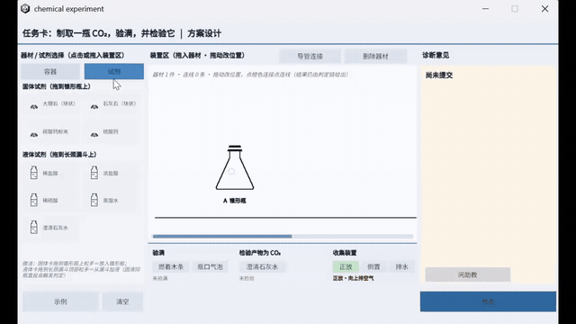

# Vchem Lab

Unity 2022.3.62f3c1 + URP 14.0.12 的中学化学虚拟实验：学生设计实验方案，系统判定并演出 3D 实验。

## 当前范围

- **实验范围**：当前完成CO2制取。  
- **设计阶段**：2D 装置拓扑（器材、端口、连线、试剂、验满/检验）→ 提交判定 → 结果诊断 + 端口定位。
- **3D 演示阶段**：由提交的 `plan.json` 装配 3D 装置，按 `vchem.timeline/1` 事件流演出。
- **判定链**：纯 C#、确定性、可脱离 Unity 批量跑；覆盖 13 类结果与 10 种典型错法（含硫酸钙、稀硫酸等干扰项）。
- **智能助教（开发中）**：`ai-service/`读取提交的 `plan/result`，提供结果解释、L1–L3 提示、关键帧问答和学习小结；默认 mock，可切云端大模型。

## 在unity中编辑与测试

Unity Hub 用 **2022.3.62f3c1** 打开本目录（`Assets/` 所在目录）。   
1. 打开场景 `Assets/Vchem/Scenes/M2_PlanPanel.unity`，Play。
2. 构建方案（或点“看示例”）→「检查」提交 →「开始实验」。
3. 「问助教」打开 AI 助教弹层；演示阶段底部也有「问助教」，会按当前关键帧提问（需先启动 `ai-service`，见下）。

## 导出 exe文件

可用 Unity 菜单 `Vchem > Build Windows Player (choose output)...` 弹窗选目录。目标目录不存在会自动创建，整包约 97MB。

## 智能助教 

```powershell
python ai-service/app.py
```

也可以直接双击 `ai-service\start.bat`（带窗口）或 `ai-service\start-silent.bat`（后台无窗口）。

> 两个脚本只在双击时启动，关闭对应进程即停止服务。

- 服务：`http://127.0.0.1:8000`；网页控制台：`http://127.0.0.1:8000/`
- 默认 mock（无需 Key）；配置 `ai-service/.env` 后自动走云端 OpenAI-compatible 接口。
- 详见 [`ai-service/README.md`](ai-service/README.md)。

### 接入云端大模型

1. 复制配置模板（`.env` 已被 `.gitignore` 忽略）：

```powershell
copy ai-service\.env.example ai-service\.env
notepad ai-service\.env
```

2. 填写四行：

```ini
LLM_BASE_URL=https://api.deepseek.com/v1
LLM_API_KEY=<你的 API Key>
LLM_MODEL=deepseek-chat
LLM_TIMEOUT=30
```

> `LLM_BASE_URL` 不要带 `/chat/completions`，程序会自动拼接。

## 演示  



## 目录

- `Assets/Vchem/Core/`：判定链、数据契约、时间轴合成（纯 C#）。
- `Assets/Vchem/UI/`：方案设计面板（线稿器材 + 端口）。
- `Assets/Vchem/Runtime/Assembly/`：装配器。
- `Assets/Vchem/Runtime/Showcase/`：演出与现象基元。
- `Assets/Vchem/Authoring/Geometry/`：程序化几何。
- `Assets/Vchem/Content/`：材质、Shader、Profile、时间轴数据。
- `Assets/Vchem/Resources/VchemContent/`：Player 运行时加载的同一套内容。
- `ai-service/`：智能助教 Demo（HTTP 服务、受控知识包、mock/云端 provider、50 条评测）。
- `Tests/Golden/`、`Tools/JudgeRunner/`：可脱离 Unity 的判定回归。